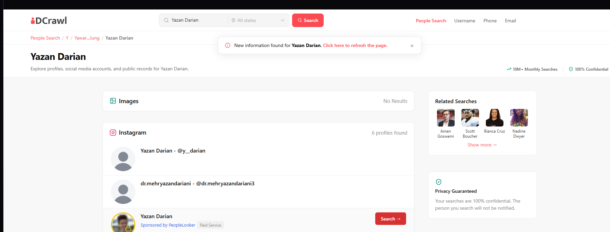
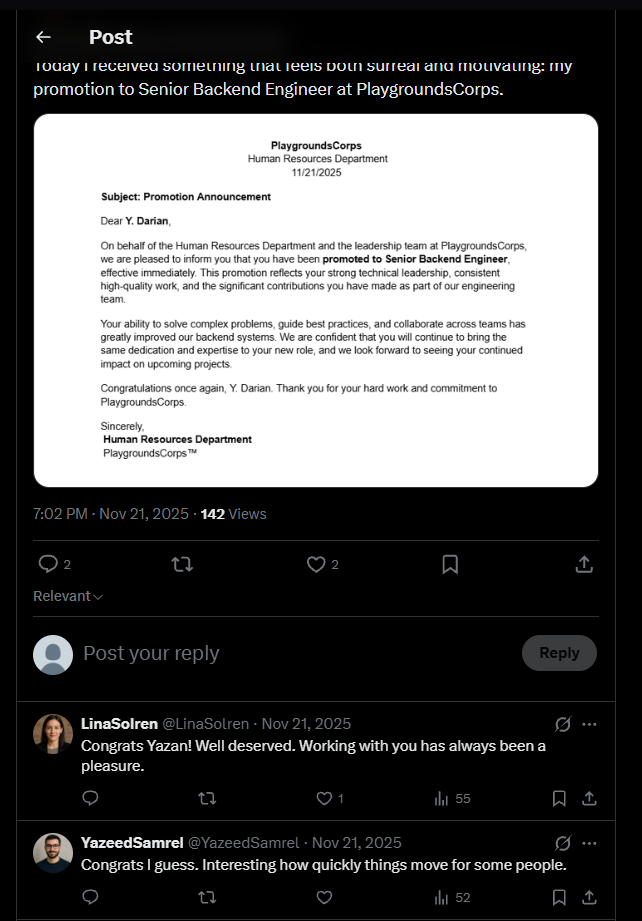
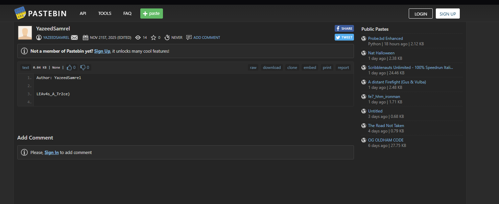

# Internal Affairs

**Event:** Playgrounds CTF · **Category:** OSINT · **Author:** jaarabd

## Description

> Yazan Darian was recently promoted to Senior Backend Engineer at PlaygroundsCorps. Since then, subtle signs of jealousy have started to surface. Odd comments and unusual activity suggest someone isn't handling his success well. Your task is to follow the clues and uncover what's really happening behind the scenes.

## Files

None. Everything is on live public accounts that I built for the challenge. Screenshots of each step are in [`screenshots/`](screenshots/) in case any account goes offline.

## Solution

### 1. Find the target's accounts

The only lead is a full name. A people search engine such as [IDCrawl](https://www.idcrawl.com) returns an Instagram profile for "Yazan Darian": `@y__darian`.



The Instagram username links to his Threads account, [`@y__darian`](https://www.threads.com/@y__darian), and Threads links to his X account, [`@yazandarian`](https://x.com/yazandarian).

### 2. Find the jealous coworker

On X, Yazan posts his promotion letter from PlaygroundsCorps. Two coworkers reply. One is supportive. The other is not:

> **@YazeedSamrel:** Congrats I guess. Interesting how quickly things move for some people.



That is the suspect. Another of Yazan's posts links his Medium, [`@Y_Darian`](https://medium.com/@Y_Darian), which has no clues. It is there to make the persona believable and to show that Medium is part of this persona network.

### 3. Pivot to the coworker's Medium

Trying the same username on Medium finds [`@yazeedsamrel`](https://medium.com/@yazeedsamrel). Two of his three posts contain clues.

**[Encoding, Hashing, and Encryption: Why They Are Not the Same](https://medium.com/@yazeedsamrel/encoding-hashing-and-encryption-why-they-are-not-the-same-9a4edbbf5741)** uses this string as its "encoding example":

```
UGxheWdyb3VuZHNDVEZ7SkVhMW91c1lZX0Exd0F5c18=
```

```bash
echo UGxheWdyb3VuZHNDVEZ7SkVhMW91c1lZX0Exd0F5c18= | base64 -d
# PlaygroundsCTF{JEa1ousYY_A1wAys_
```

That is the first half of the flag.

**[How HTML & CSS Are Used in Offensive Security and Red Teaming](https://medium.com/@yazeedsamrel/how-html-css-are-used-in-offensive-security-and-red-teaming-16641a55a953)** has a stylesheet example with a comment that fits the article's own point about forgotten comments leaking information:

```css
/* IMPORTANT: find me in pastebin for second part of the flag.*/
```

### 4. Pivot to Pastebin

The same username on Pastebin, [`YazeedSamrel`](https://pastebin.com/u/YazeedSamrel), has one paste, [`4MxhbTMq`](https://pastebin.com/4MxhbTMq):

```
Author: YazeedSamrel

LEAv4s_A_Tr2ce}
```



### 5. Flag

```
PlaygroundsCTF{JEa1ousYY_A1wAys_LEAv4s_A_Tr2ce}
```

## Design notes

- **Username reuse is the core skill.** Each pivot (Instagram to Threads to X, then X to Medium to Pastebin) works because the persona reuses one handle across platforms. This is the most common way real investigations link accounts.
- **Reading social context, not just profiles.** The suspect is never named in the challenge. The player has to read the replies to a post and decide who fits "isn't handling his success well."
- **Clues that fit the persona.** The base64 string sits in an article about encoding, and the Pastebin hint sits in a CSS comment in an article about how comments leak data. Both look like normal content for a security blogger, so skimming the articles is not enough.
- **Decoy content.** Yazan's own Medium posts and the supportive coworker's reply lead nowhere. They make the network look real and test whether the player stays focused on the suspect.
- **Split flag.** Neither half is useful alone, so the player has to finish the whole chain.
